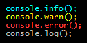

# paint-console

This package just repaint console.

### Installation

`pnpm install -D @jeniex/paint-console`

### Usage

```javascript
import '@jeniex/paint-console';

console.info('An info message');
console.warn('A warn message');
console.error('An error message');
```

```javascript
require('@jeniex/paint-console');

console.info('An info message');
console.warn('A warn message');
console.error('An error message');
```

### Demo



### Source

[view source](https://github.com/JenieX/paint-console/blob/master/src/index.ts)
